<div align="center">


# 豆藏 · COFFEE VAULT

**一款给重度咖啡爱好者自用的 macOS 咖啡豆管理应用**

从一袋豆子烘焙完成的那天起，追踪它什么时候能喝、什么时候最好喝、还能喝几杯、每杯花多少钱。

数据 100% 保存在本机，不联网、不上传、不注册。


</div>

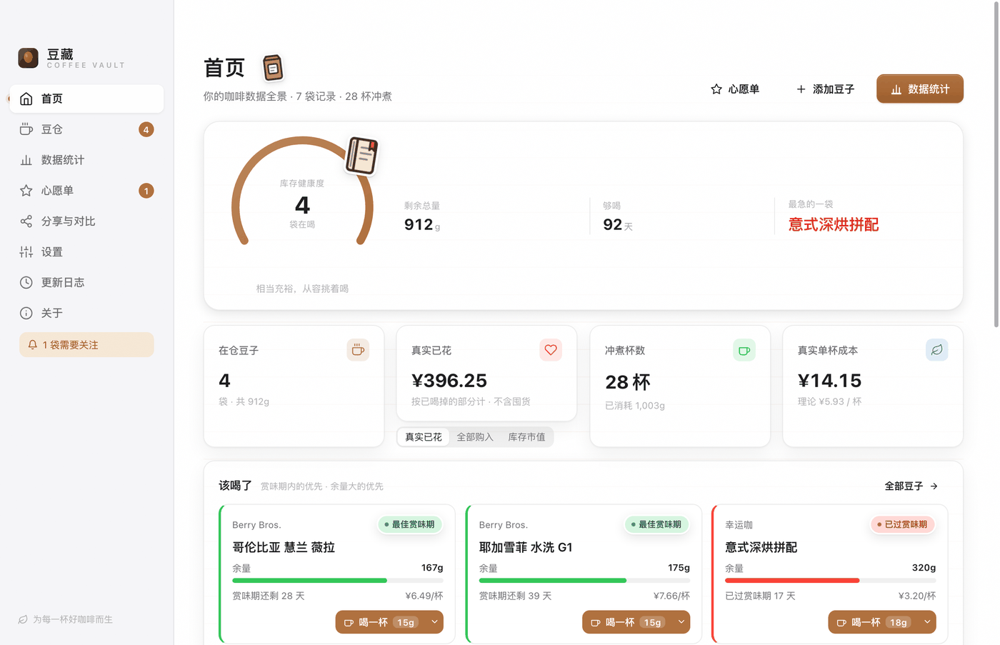

---

## 为什么做这个

家里常备四五袋豆子，买回来就忘了烘焙日期。等想起来，要么还在养豆期、喝出来一股燥气，要么早就过了赏味期、香气全跑光。

市面上的咖啡 App 大多面向手冲玩家或门店管理，要注册账号、要把数据传到云上，还顺手推荐你买豆子。我只想要一个：

- 打开就知道**今天该喝哪袋**
- 喝完顺手记一笔，**不用填表**
- 月底想知道**这钱是怎么花掉的**

于是断断续续写了这个。Electron + React，纯本地，单机可用。

---

## 功能

### ☕ 养豆期追踪，不是瞎猜

每袋豆子的养豆期和赏味期，按烘焙度给推荐值：

| 烘焙度 | 养豆期 | 赏味期 |
|---|---|---|
| 浅烘 | 12 天 | 40 天 |
| 中烘 | 7 天 | 30 天 |
| 深烘 | 4 天 | 20 天 |

每袋还能单独覆盖。深烘的意式豆和浅烘的埃塞，本来就不该用一套参数。

首页「该喝了」按**赏味期剩余天数**和**余量**排序，告诉你今天开哪袋。

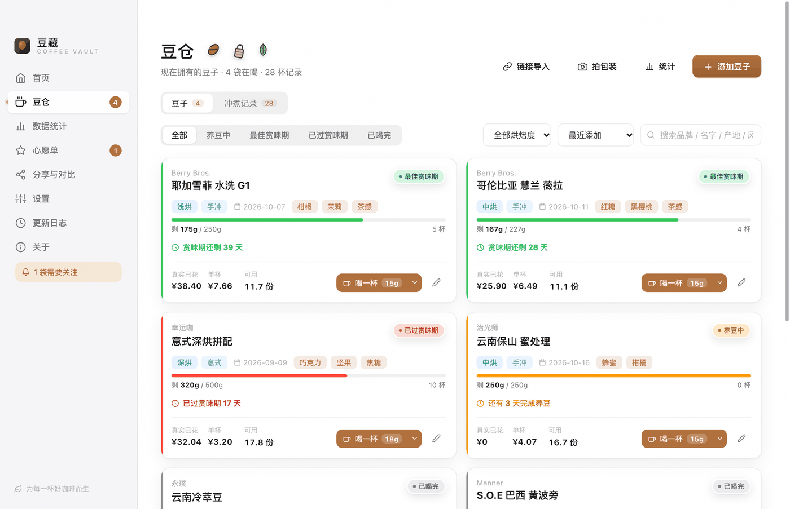

### ⚡ 一键记一杯

点一下就记完，不弹表单。

- 主按钮按这袋豆子的**默认方案**直接记：手冲 15g / 意式 18g / 冷萃 20g
- 右侧小箭头切另外两档
- 记完给 **6 秒撤销**，包含"记到最后一杯自动归档"的回滚
- 60 秒内重复点同一方案，会问一句「再记一杯？」，防手抖
- 需要记克数、粉水比、评分、心得的场合，详情页保留「精确记录」和「用上次参数」

<div align="center">
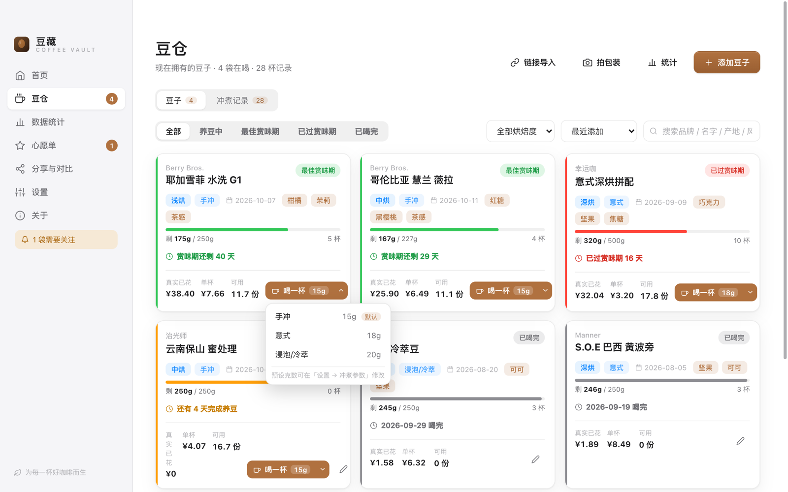
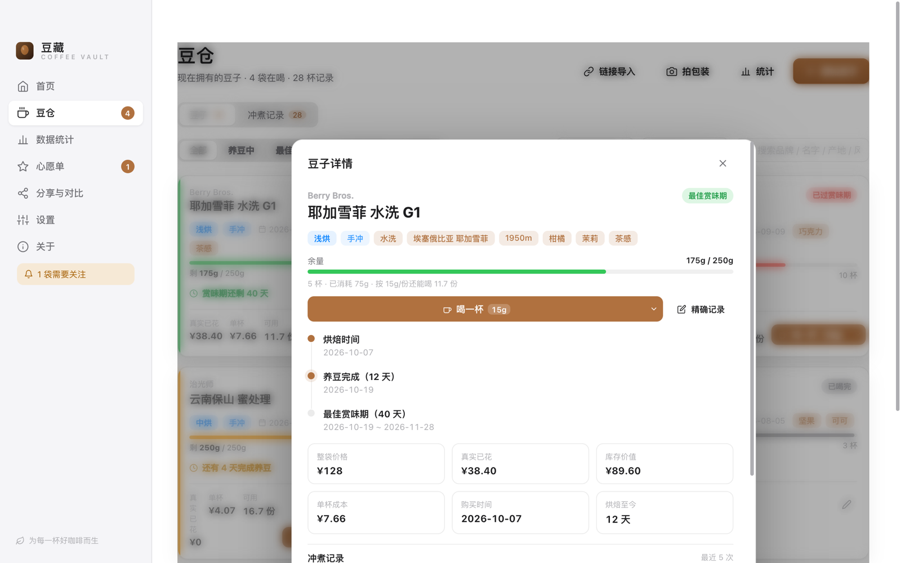
</div>

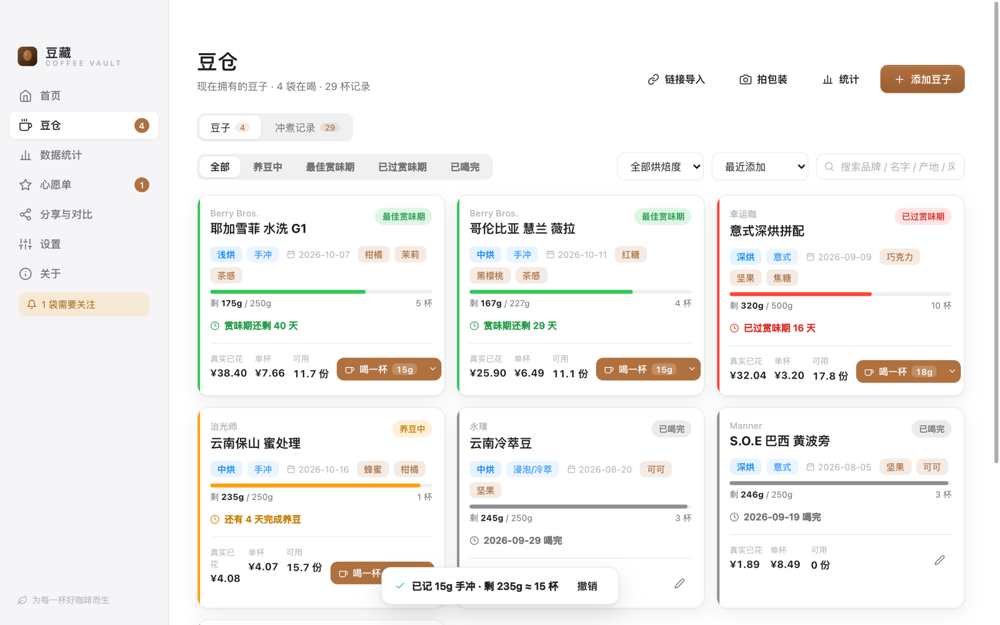

### 💰 三种花费口径，不糊弄自己

| 口径 | 含义 |
|---|---|
| **全部购入** | 所有买过的豆子总价 |
| **真实已花** | 按已喝掉的部分折算，不含库存 |
| **库存市值** | 还躺在罐子里那些值多少钱 |

真实单杯成本 = 真实已花 ÷ 已喝杯数。想知道自己喝一杯到底花多少，看这个数。

### 📊 统计页

品牌排行、烘焙度 × 评分、风味 × 评分、月度购入/消耗双轴、复购率、喝的速度与库存可撑天数、评分榜。

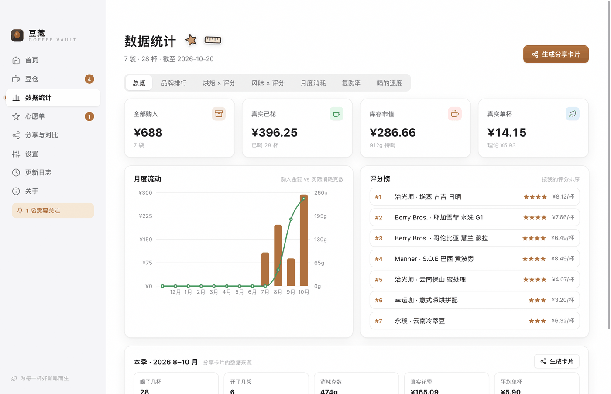

<div align="center">
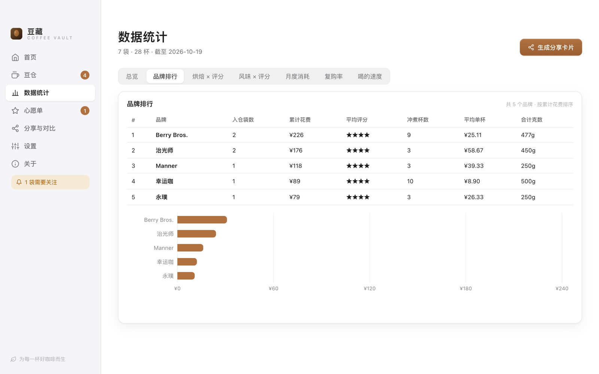
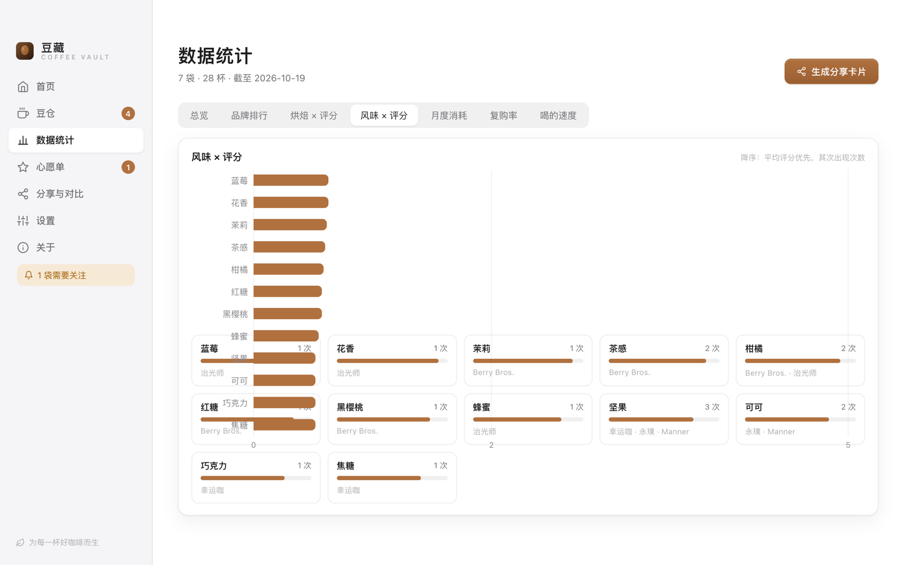
</div>

### 📷 拍包装识标签

拍一张包装背面，macOS Vision 本地 OCR 认出烘焙日期、产地、处理法、净含量、价格、烘焙度、海拔、风味。**图片不上传。**

首次使用会现场编译一个 Swift 桥接（约 15–20 秒），之后有缓存。需要 `xcode-select --install`。

### 🌐 链接导入 + 浏览器采集扩展

贴淘宝 / 天猫 / 京东链接或整段商品文案，本地解析出品牌、价格、克重、烘焙日期。

`extension/` 目录是一个 Chrome / Edge MV3 扩展，在商品页一键采集，只与本机 `127.0.0.1:47823` 通信。

### 🔁 一键回购

一袋喝完，点「回购」：原价、原链接、回购次数一起进心愿单；也可以「再来一袋」复制成新批次。

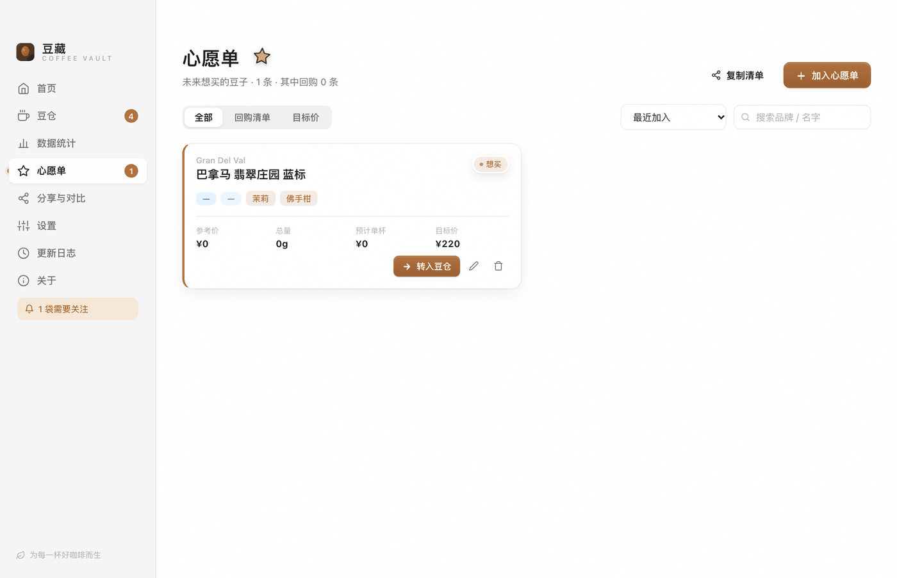

### 👥 分享卡片

「本季我喝了什么」季报、单袋豆子卡片，1080px 2x 导出 PNG。不发到任何服务器，就是本地画一张图。

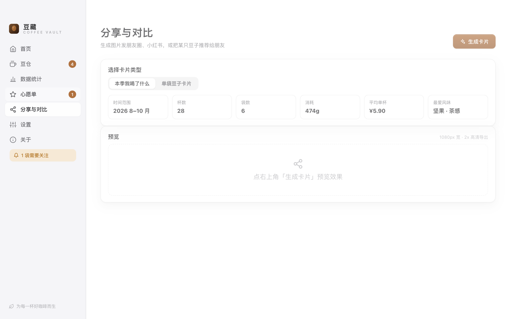

### 📤 导出 Excel / 打印豆册

Excel 6 个工作表；「美式豆册」A4 两列排版，每袋一张卡，打印或存 PDF。

### 🌙 深浅色

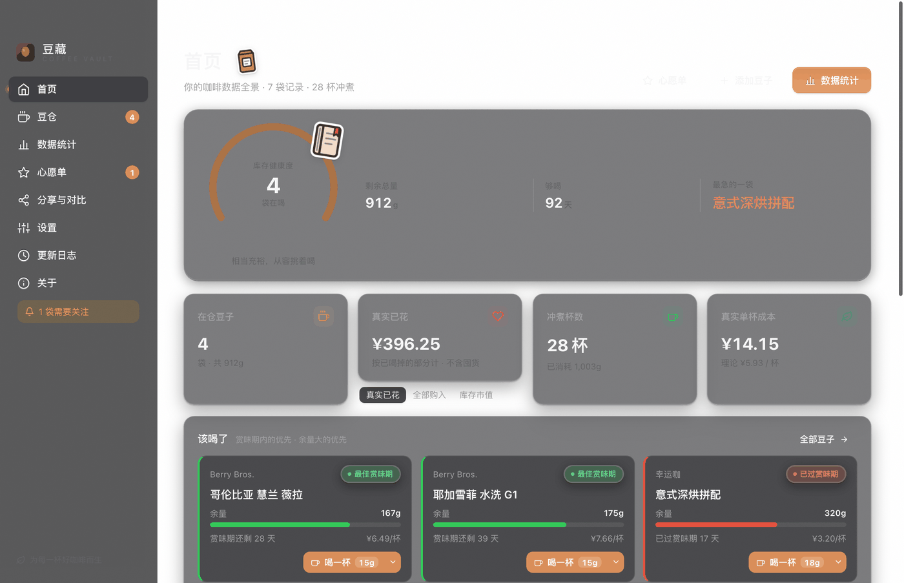

### 🛟 数据安全

- v1 → v2 自动迁移，**迁移前留档**
- 读文件失败时留档 `data.corrupt-*.json`，**绝不用空数据覆盖原文件**
- 每天自动备份，保留 20 天
- 导入前预览，冲突三选：跳过 / 覆盖 / 新批次

---

## 安装

### 直接下 DMG

到 [Releases](https://github.com/xlyang/豆藏/releases/latest) 下载：

- Apple 芯片（M 系列）→ `豆藏-x.y.z-arm64.dmg`
- Intel 芯片 → `豆藏-x.y.z-x64.dmg`

> **首次打开**：应用没有做 Apple 公证，双击会被拦。请**右键点应用 → 打开**，或执行：
> ```bash
> xattr -dr com.apple.quarantine /Applications/豆藏.app
> ```

### 从源码跑

```bash
git clone https://github.com/xlyang/豆藏.git
cd 豆藏

# 推荐 pnpm（仓库根有 pnpm-workspace.yaml + .npmrc hoisted 配置）
pnpm install
# 或者 npm install

pnpm dev        # 构建渲染层后启动 Electron
pnpm build      # 只构建渲染层
pnpm test       # 单元测试（64 条）
pnpm smoke      # 端到端冒烟
pnpm preview    # 生成 .preview/index.html，浏览器里看界面
pnpm dist       # 打包 DMG（mac，arm64 + x64）
```

依赖：Node 18+、macOS 11+、Xcode Command Line Tools（OCR 用）。

---

## 数据在哪

| 内容 | 路径 |
|---|---|
| 主数据 | `~/Library/Application Support/豆藏/data.json` |
| 迁移留档 | `.../data.pre-v2-*.json` |
| 损坏留档 | `.../data.corrupt-*.json` |
| 自动备份 | `.../backups/`（保留 20 天） |
| 活动日志 | `.../activity.log` |

想换机器，把 `data.json` 拷过去即可。

开发时可用 `DOUCANG_DATA_DIR=/tmp/xxx` 指定别的目录，不会碰真实数据。

---

## 技术栈

| 层 | 选型 |
|---|---|
| 外壳 | Electron 31（`electron/main.mjs`，ESM） |
| 界面 | React 18 + Vite 5，无 UI 框架，手写 CSS |
| 图表 | Recharts |
| 导出 | ExcelJS + 手写 A4 打印模板 |
| OCR | macOS Vision（Swift 桥接，编译成二进制后调用） |
| 打包 | electron-builder（adhoc 签名） |

### 代码结构

```
electron/           主进程
  main.mjs          应用入口、数据读写与迁移、IPC、通知
  preload.cjs       渲染层 API 桥（contextIsolation）
  localServer.cjs   本机采集服务 :47823
  productParser.cjs 淘宝/天猫/京东链接与文案解析
  labelParser.cjs   包装标签文本 → 字段
  ocr/              macOS Vision 桥接（Swift + 编译脚本）
  excelExport.cjs   Excel 导出
  printTemplate.cjs 豆册 A4 模板
  notifier.cjs      养豆 / 赏味期 / 余量提醒
src/
  lib/calc.js       ★ 计算单一真相源（resolveBean）
  lib/stats.js      统计聚合
  lib/quickBrew.js  一键记一杯的预设与去重
  lib/shareCard.js  分享卡片 Canvas 绘制
  lib/schema.mjs    数据结构归一化与默认值
  store/            React Context 全局状态
  components/       通用组件
  pages/            六个页面
  styles/motion.css ★ 动效层（Apple HIG）
extension/          Chrome / Edge 采集扩展（MV3）
tests/              单元测试（node --test）
scripts/            冒烟、预览、图标、签名钩子
docs/               文档与截图
```

**核心约定**：养豆窗口、状态判断、份数、单杯成本、余量，全部由 `src/lib/calc.js` 的 `resolveBean()` 算一次，页面不许各自重算。改逻辑只改一处。

### 计算公式

- 养豆完成日 = 烘焙时间 + 养豆天数（每袋参数 > 烘焙度推荐 > 全局兜底）
- 最佳赏味期 = [养豆完成日, 养豆完成日 + 赏味天数]
- 剩余克数 = 总量 − Σ冲煮用量（喝完时以「喝完时余量」为准）
- 可做份数 = 总量或剩余 ÷ 该袋冲煮方式的单份克数
- 单杯费用 = 整袋价格 ÷ 可做份数
- 真实已花 = Σ(用量 × 每克单价)；库存市值 = Σ(剩余克数 × 每克单价)

---

## 浏览器采集扩展

在 Chrome 打开 `chrome://extensions` → 开发者模式 → 加载已解压 → 选择 `extension` 文件夹。详见 `extension/README.md`。

> 应用里开的本地服务端口是 `47823`，装新版前请先退出旧版，否则两者会抢同一个端口。

---

## 已知限制

- **没有 Apple 公证**：首次打开需右键 → 打开。自己用或分给朋友够用；上架 App Store 需要开发者账号。
- **只有 macOS**：OCR 依赖 Vision 框架，Windows 版需要换 Tesseract。
- **打包必须用 `pnpm dist` / `npm run dist`**：直接敲 `electron-builder` 会漏掉 `afterSign` 钩子，产物只有 linker-signed adhoc 签名，**启动即静默挂起且不报错**。

  ```bash
  # 检查产物签名
  codesign -dv release/mac-arm64/豆藏.app 2>&1 | grep CodeDirectory
  # 正常应含 flags=0x2(adhoc)；若为 0x20002(adhoc,linker-signed) 说明漏了 afterSign
  ```

---

## 路线图

- [x] 豆仓、养豆期、成本三口径
- [x] 冲煮记录、统计页
- [x] OCR 识标签、链接导入、采集扩展
- [x] 分享卡片、Excel、豆册
- [x] 一键记一杯 + 撤销 + Apple HIG 动效
- [ ] 风味轮与杯测评分（SCA 表）
- [ ] 冲煮参数模板库（V60 / 聪明杯 / 意式，可存多套）
- [ ] 豆子生命周期图（养豆 → 巅峰 → 衰退，一条时间轴）
- [ ] 菜单栏快捷入口（不打开主窗口也能记一杯）
- [ ] 多设备同步（可选，走 iCloud Drive 或自建）
- [ ] Windows 版

---

## 更新日志

见 [CHANGELOG.md](CHANGELOG.md)。

## 参与

自己用的工具，但欢迎提 issue 说需求、报 bug。提交与发版流程见 [CONTRIBUTING.md](CONTRIBUTING.md)。

## 许可

[MIT](LICENSE) © xlyang
